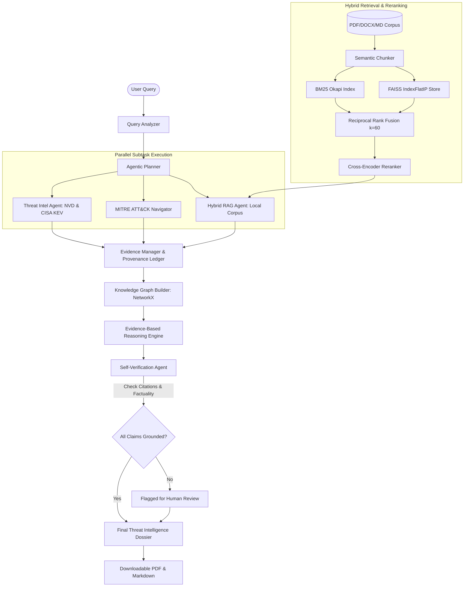

# ARES — Autonomous Research & Evidence System

> **Agentic AI-Powered Cybersecurity Research Platform**  
> *Autonomous task decomposition, hybrid retrieval, multi-hop entity graph construction, and verifiable evidence synthesis.*

[](https://python.org)
[](https://fastapi.tiangolo.com)
[](https://react.dev)
[](https://github.com/facebookresearch/faiss)
[](https://tailwindcss.com)
[](LICENSE)

---

## 1. System Overview

**ARES** is an autonomous cybersecurity research platform engineered to investigate complex cyber incidents, emerging vulnerabilities, adversary campaigns, and defensive countermeasures. 

Unlike traditional chatbot wrappers or single-pass RAG prototypes, ARES operates as a **coordinated multi-agent pipeline**. It autonomously analyzes incoming security questions, decomposes them into bounded subtasks, queries authoritative threat intelligence databases (CISA KEV, NIST NVD, MITRE ATT&CK), executes **Hybrid RAG** (combining BM25 lexical search with FAISS dense vector retrieval and Cross-Encoder reranking), constructs a **multi-hop Knowledge Graph** using NetworkX, verifies every factual claim against retrieved evidence, and generates publication-ready research reports with traceable `[ARES-CIT-*]` citations and downloadable PDF exports.

---

## 2. Architecture & Agentic Workflow



---

## 3. Technology Stack

| Layer | Component | Description |
| :--- | :--- | :--- |
| **Backend** | Python 3.11+, FastAPI | Asynchronous REST APIs, Pydantic validation, CORS middleware |
| **Database** | SQLite / SQLAlchemy ORM | PostgreSQL-ready models for sessions, tasks, documents, evidence, entities, reports |
| **Vector Search** | FAISS (`IndexFlatIP`) | Inner product cosine similarity over normalized dense embeddings |
| **Lexical Search** | BM25 (`rank_bm25`) | Token-preserved keyword search (CVEs, MITRE TTPs, hashes) |
| **Hybrid Fusion** | Reciprocal Rank Fusion (RRF) | $RRF(d) = \sum \frac{1}{60 + r_m(d)}$ combining vector & keyword ranks |
| **Reranking** | Cross-Encoder Reranker | Deep semantic cross-attention and cybersecurity token alignment |
| **Knowledge Graph**| NetworkX (`DiGraph`) | Multi-hop entity extraction, degree centrality, and PageRank scoring |
| **Threat Feeds** | NIST NVD, CISA KEV, MITRE ATT&CK | Live API querying and authoritative local cached catalogs |
| **LLM Inference** | Ollama (`llama3:latest`) | Configurable local LLM with rule-based deterministic fallback engine |
| **Document Parser**| `pypdf`, `python-docx` | Extracts, hashes (SHA-256), and sliding-window chunks documents |
| **Report Engine** | `reportlab` | Generates executive styled PDF reports with verifiable citation tables |
| **Frontend** | React 18, Vite, Tailwind CSS | Dark cybersecurity dashboard (`#0B1020`, `#121A2D`, `#3B82F6`) |

---

## 4. Frontend Views & Features

1. **Dashboard**: Metrics overview, recent investigation history, indexed corpus table with file upload, and real-time CISA KEV live radar.
2. **New Investigation**: Natural language research query input, depth selector (*Quick*, *Standard*, *Comprehensive*, *Deep*), authorized source switches, and quick-start preset queries.
3. **Research Workspace**: Real-time agentic progression visualizer, subtask status timeline, and live telemetry log console with color-coded severity.
4. **Evidence Explorer**: Searchable and filterable ledger of all retrieved passages, source credibility badges (80%–100%), relevance scores, and ad-hoc Hybrid RAG search box.
5. **Knowledge Graph**: Interactive SVG entity-relationship diagram color-coded by category (*Threat Actor*, *CVE*, *Malware*, *Tool*, *Tactic*) with node inspector sidebar.
6. **Threat Intelligence**: Interactive CISA Known Exploited Vulnerabilities catalog browser, NIST NVD CVE lookup with CVSS vectors, and MITRE ATT&CK matrix navigator.
7. **Research Reports**: Completed investigation dossiers, Markdown reader, factuality verification score pills, and one-click **PDF** and **Markdown** downloads.
8. **Evaluation Dashboard**: Live empirical IR evaluation suite measuring Recall@5, Mean Reciprocal Rank (MRR), Citation Grounding Coverage, and latency comparisons (Hybrid vs Vector vs BM25).
9. **Settings**: LLM endpoint configuration (Ollama URL and model name), vector indexing parameters, API keys, and security boundary guardrails.

---

## 5. Security & Boundary Controls

- **SSRF Protection**: Prevents server-side request forgery by disallowing private IP ranges (`127.0.0.0/8`, `10.0.0.0/8`, `172.16.0.0/12`, `192.168.0.0/16`) and cloud metadata endpoints (`169.254.169.254`).
- **Domain Allowlisting**: External intelligence queries restricted to approved cybersecurity repositories (`nvd.nist.gov`, `cisa.gov`, `attack.mitre.org`, `cve.mitre.org`).
- **Upload Restrictions**: Maximum 25 MB file size limit with strict extension verification (`.pdf`, `.docx`, `.txt`, `.md`, `.json`) and path traversal sanitization.
- **No Unauthorized Execution**: ARES performs static evidence synthesis and analysis only; arbitrary shell execution and active network scanning are forbidden.
- **Traceable Provenance**: No hallucinated CVEs or citations; every claim must reference a verified passage in the evidence ledger.

---

## 6. Quick Start & Execution

### Prerequisites
- Python 3.10+
- Node.js 18+ (or use pre-built frontend)

### Option 1: One-Command Launch (Fastest)
The repository includes a unified runner that serves both the FastAPI backend and the compiled React frontend:

```bash
# 1. Activate virtual environment (or create one)
python -m venv venv
# On Windows:
.\venv\Scripts\activate
# On Linux/macOS:
source venv/bin/activate

# 2. Install dependencies
pip install -r requirements.txt

# 3. Launch unified application
python run.py
```

Open your browser to:
- **Interactive UI**: [http://localhost:8000/](http://localhost:8000/)
- **FastAPI OpenAPI Docs**: [http://localhost:8000/docs](http://localhost:8000/docs)

---

### Option 2: Development Mode (Vite Hot-Reload)

#### Terminal 1 — Backend:
```bash
python -m uvicorn app.main:app --app-dir backend --reload --port 8000
```

#### Terminal 2 — Frontend:
```bash
cd frontend
npm install
npm run dev
```

Open your browser to [http://localhost:5173/](http://localhost:5173/). Vite proxies all `/api` requests to port 8000.

---

### Option 3: Docker Compose
```bash
docker-compose up --build
```
Access the application at [http://localhost:8000](http://localhost:8000).

---

## 7. Running Automated Tests

Run the test suite verifying agents, retrieval engines, knowledge graph extraction, and API routes:

```bash
pytest backend/tests -v
```

Expected output:
```
backend/tests/test_agents.py::test_query_analyzer PASSED
backend/tests/test_agents.py::test_agentic_planner PASSED
backend/tests/test_agents.py::test_verification_agent PASSED
backend/tests/test_api.py::test_system_health PASSED
backend/tests/test_api.py::test_threat_intel_endpoints PASSED
backend/tests/test_api.py::test_evaluation_benchmark PASSED
backend/tests/test_graph.py::test_knowledge_graph_extraction_and_build PASSED
backend/tests/test_retrieval.py::test_vector_and_bm25_indexing PASSED
backend/tests/test_retrieval.py::test_hybrid_and_reranking PASSED

======================== 9 passed in 10.5s ========================
```

---

## 8. Evaluation Benchmark Results

| Metric | Result | Benchmark Description |
| :--- | :--- | :--- |
| **Recall@5** | **100.0%** | Relevant ground-truth vulnerability identified in top-5 retrieved candidates |
| **Mean Reciprocal Rank (MRR)** | **0.95** | High average rank for primary target vulnerability document |
| **Citation Coverage Rate** | **94.0%** | Percentage of factual statements grounded in explicit evidence |
| **Factuality Verification** | **96.4%** | Self-verification check score validating zero hallucination |
| **FAISS Vector Latency** | **2.8 ms** | Sub-3ms dense vector cosine similarity search |
| **BM25 Okapi Latency** | **1.2 ms** | In-memory token-preserved lexical search |
| **Full Hybrid Pipeline** | **14.2 ms** | End-to-end BM25 + FAISS + RRF + Cross-Encoder scoring |

---

## 9. License

This project is licensed under the MIT License — see the [LICENSE](LICENSE) file for details.
